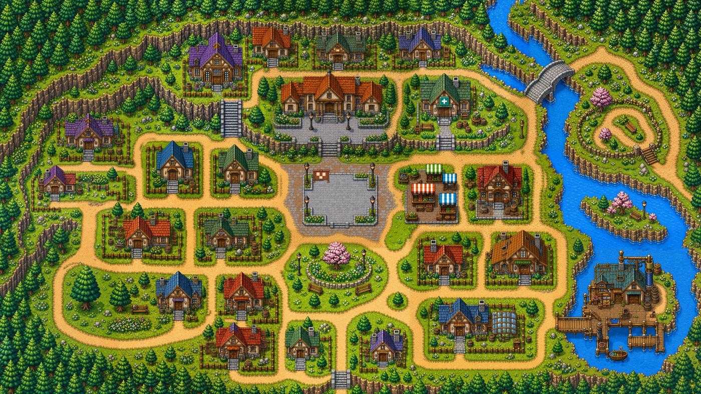
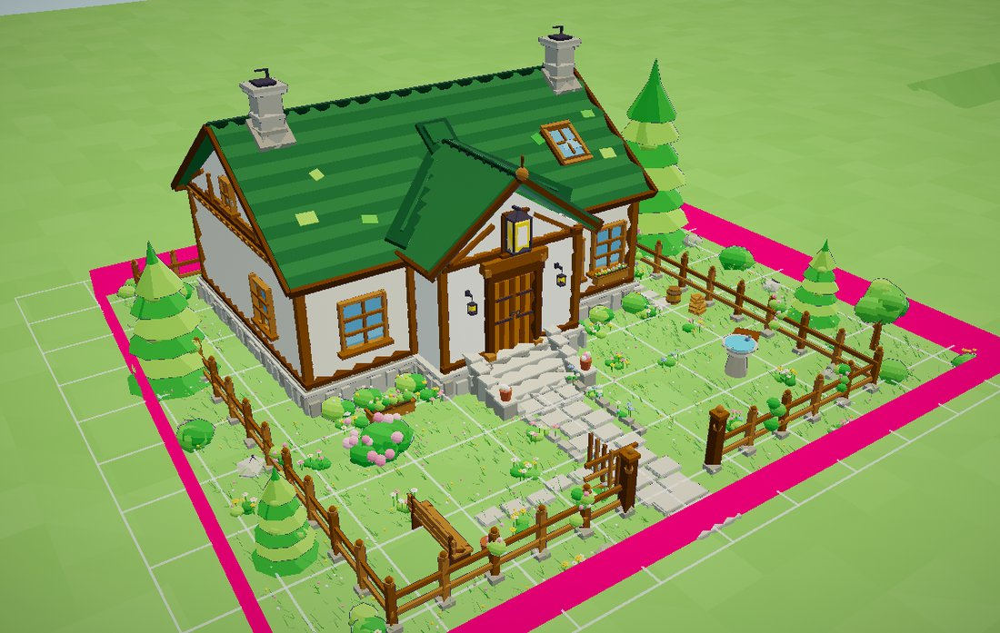
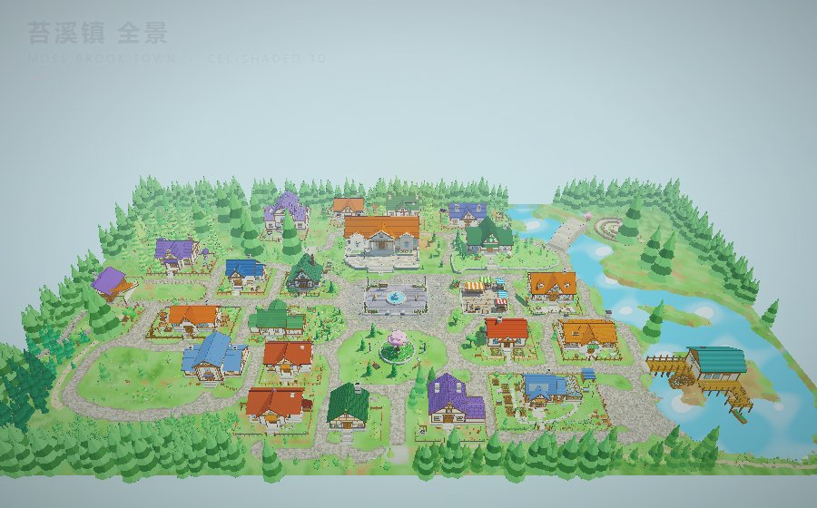
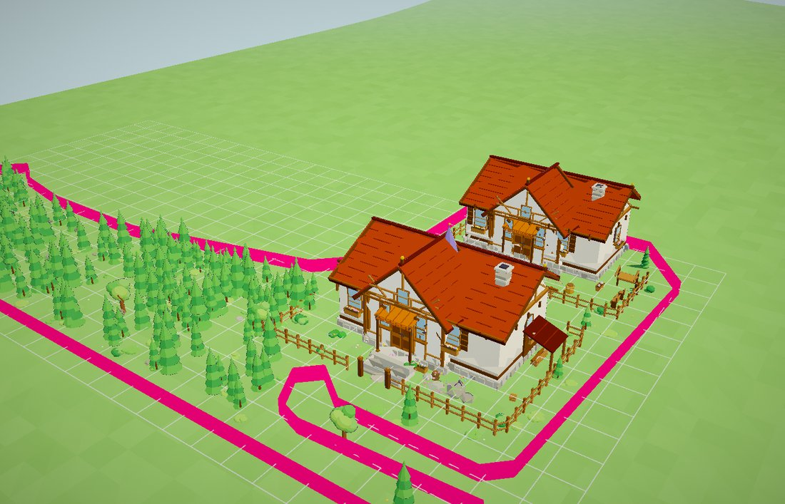
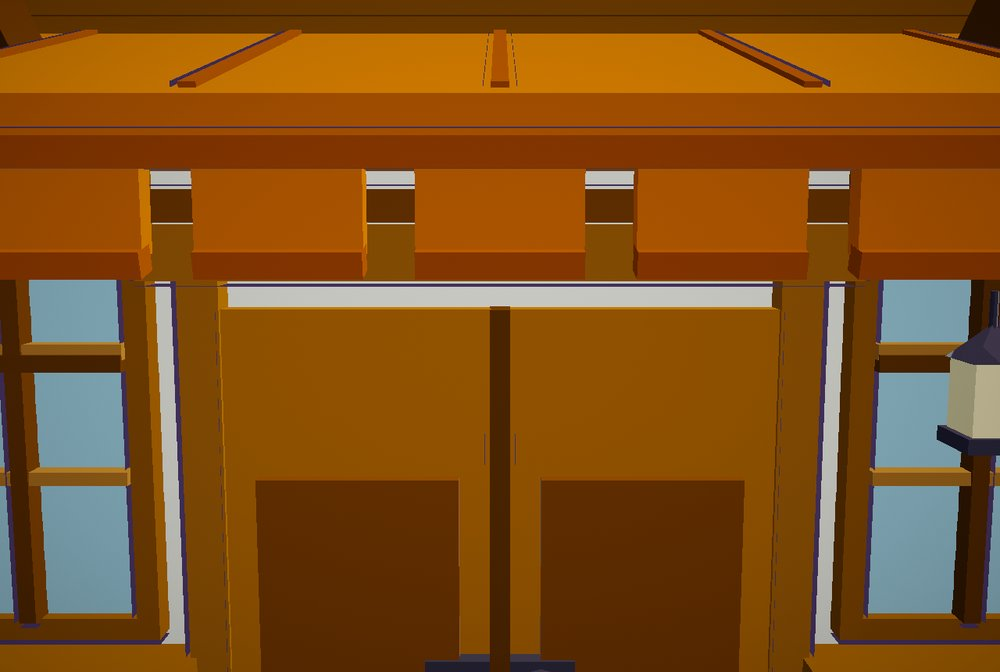

# 从一栋房子到一座小镇：粗 → 细的分割工作法

> 一个 AI 造景踩坑记录 + 可复用的方法论。
> 目标读者：用 AI Agent（子代理 / 外部 CLI / 人）批量生产**大场景资产**的人。
> 案例：把一张 6688×3764 的像素风俯视地图，用 three.js 重做成 23 个地块的 3D 小镇——**254 万三角、60 FPS、0 报错**。

---

## TL;DR

**把一整个小镇丢给 AI，它一定做得很粗糙；把小镇切成 23 块，一块一块给它，每块都能做得很细。**

这不是模型能力问题，是**任务粒度**问题。整镇一次生成必然粗糙，原因有三，而且三条都是结构性的：

| 机制 | 后果 |
|---|---|
| **注意力预算被摊薄** | 模型的"细节预算"是有限的。摊到 23 栋房子上，每栋只分到 1/23 的用心 → 全是方盒子 + 一个坡屋顶 |
| **没有局部验收** | 整镇只能"整体看好不好看"，你无法对第 17 栋房子说"这扇窗位置低了 20 cm"。**不可验收 = 不可改进** |
| **错误不可定位** | 一个地方崩了，你不知道是哪；改一处又崩另一处。迭代速度降到接近零 |

所以这套方法论的内核只有一句话：

> **不要"生成一座小镇"，要"定义一座小镇的数据 + 一个地块的接口 + 一条验收闸"，然后批量填充。**

也就是说：**把「一次性生成」拆成「建模 → 切分 → 接口化 → 派发 → 验收 → 合并」。**

---

## 零、先看四张图（这就是全部差别）

**输入**：一张像素风俯视地图。它只提供**布局**，颜色和画风都要自己定。



**① 打样**：先手工做一栋，做到满意。它不是"示例"，是后面 23 块的**质量锚 + 风格母本 + 组件库**。


**② 切分 + 派发**：地图被切成 23 个多边形地块，每块一个文件、一个 Agent、一条闸。
下面这张是单个地块的验收视图（品红是**真实轮廓多边形**，白线是外接框网格——两者不是一个东西）：



**③ 合并**：23 块拼回一座镇。**2,549,108 三角 / 60.1 FPS / 0 页面错误 / 单文件 HTML 双击可开。**



> 左边那张图到下面这张图之间，没有任何"更强的模型"参与。
> 差别只有一个：**任务粒度**。详见下面六个阶段。

---

## 一、先看结论：这个方法跑出来的结果

同一个项目，前后两种做法的对比（真实数据，见 [`docs/case-study.md`](docs/case-study.md)）：

| 指标 | 整镇一次生成（早期） | 切块 + 派发（后期） |
|---|---|---|
| 单栋房屋三角数 | 几百～几千 | **20,314 ～ 194,015** |
| 单块最高密度 | — | **127,786 三角 / 377 m²**（每平米 339 个三角） |
| 有名字的构件段 | 无分段概念 | 单块最多 **18 段**（台基/墙/木构/瓦/窗/栅栏/井/花坛…） |
| 整镇规模 | 约 1.0 MB HTML | **2,549,108 三角 / 60.1 FPS / 0 页面错误** |
| 能否定位错误 | 不能 | 每个地块失败会被单独捕获并上报 |

单块"密度标杆"是 20 号（蓝瓦小屋 + 玻璃温室，377 m² 铺满，1772 行代码，15 个分段）。
在案例里，所有派发提示词都**直接指向这个文件**（`yard_20.html`）当质量标准——不是描述"要精细"，
而是"打开这个文件，你的密度不能比它低"。



> 上图是单个地块的验收视图：品红多边形是**真实轮廓**，白色网格是**外接框**——
> 两者不是一回事（这张图里能直接看出外接框在四个角多出来的部分，那里是马路）。
> 下面这张图是同一个标准推到最近的样子：



---

## 二、六个阶段（这是方法论的骨架）

```
① 打样  →  ② 建模  →  ③ 切分  →  ④ 接口化  →  ⑤ 派发  →  ⑥ 验收合并
 一栋做绝   地图→数据   划出地块    一地块一文件    并行填充     自己动手验
```

每个阶段都有一个**"必须产出物"**。缺了任何一个，后面都会退化成"一次生成整镇"。

### ① 打样：先做一栋，做到你觉得"这就是上限"

在做任何分割之前，先**手工（或高强度单点）做一栋房子**，做到你满意为止。

- 它同时是**质量锚**（后面所有派发都指着它说"照这个密度"）、**风格母本**（配色/描边/光照）
  和**资产库**（它的墙体/屋顶/窗是后面所有地块复用的组件）。
- 案例里这一步的产物是 `town-cottage.html`：单栋蓝瓦小屋 + 暖房 + 院子，**37 万三角**，790 KB。

> **为什么这一步不能跳**：没有质量锚，"精细一点"就是一句空话。人无法执行、AI 也无法执行。
> 有了质量锚之后，验收判据从"好不好看"（主观、不可执行）变成"密度有没有到 20 号那样"（客观、可执行）。

**打样阶段的三个副产品，比房子本身更值钱：**

1. **建造原语（builder）**——一个 `b.box / b.cyl / b.sphere` 之类的极简几何 API
2. **组件库（kit）**——`railFence / stonePath / barrel / planter / lampPost / treeConifer…` 18 种现成件
3. **画风参数**——描边宽度、色彩调色板、三渲二光照的一整套数值

### ② 建模：把图变成**数据**，不要变成"一张图给人看"

俯视图不能直接喂给 AI 让它"照着重做"。它需要变成结构化数据：

| 数据 | 内容 | 案例值 |
|---|---|---|
| **比例尺** | 用一个已知尺寸的锚点反推 | 地图上 591 px 宽的院子 ≈ 3D 里 16 m → `36.938 px/m` |
| **世界尺寸** | 地图 × 比例尺 | 6688×3764 px → **181 × 102 m** |
| **地面分类** | 降采样后按 HSV 分类 | 320×180 栅格 → `G 草 / R 路 / S 石 / W 水 / F 林 / P 土` |
| **地块多边形** | 每块地的**真实轮廓**（不是外接框！） | 23 个多边形，编号 0–22 |
| **地形高度** | 每个点的高度采样函数 | `ground(x, z)` |

> ⚠️ **一个反直觉的教训：全自动分割建筑，失败了四轮。最后是让用户手动框选。**
>
> 试过并按顺序失败的：按色相分族（树冠和屋顶在颜色空间里重叠）、加"平坦度"判据
> （屋顶有瓦缝、树冠也有受光面）、加"凸度"判据（手绘地图的房屋轮廓也不规则）、
> 检测"奶油色墙面"（墙色太灰，阈值调不出来）。
>
> **结论：在这种"人眼一秒能分、算法很难分"的任务上，别追求全自动。**
> 让用户在地图上手绘黑框（23 个），然后用一个**对手绘完全不敏感**的提取法：
> `纯黑像素 → 从图像边界 flood fill 外部 → 剩下的就是框内`。
> 这个方法对"框互相接触、框线粗细不匀、手绘歪斜"全部免疫，比连通域分析靠谱一个量级。
>
> **人的 5 分钟 > 算法的 4 轮失败。**

### ③ 切分：切割单位要选"有语义的边界"

**关键判断：不要切成方格，要切成"有意义的单元"。**

案例里切的单位是**地块（plot）**——一栋房子 + 它管理的那块院子/菜园/围栏范围。
这个边界天然存在：**道路网络已经把小镇切成不规则街区了**，每个绿色街区就是它上面那栋房子的管辖范围。

于是切分规则变成了：`非路 且 非水` = 地块（森林也算，因为街区里的树属于这个街区）。

**切分之后必须立刻生成一张"地块元数据表"**，每个地块至少要有：

```json
{
  "id": 18,
  "centre": [x, z],
  "polygon": [[x,z], ...],     // 真实轮廓，不是 bounds
  "bounds":  {"x0":..,"x1":..,"z0":..,"z1":..},
  "area_m2": 609,
  "ground":  "height sampler ref",
  "house":   "house spec or null"
}
```

> ⚠️ **`bounds` 和 `polygon` 是两个东西，混用会出事。**
> 案例里地块外接框比真实多边形**大 19.2%**，四角是斜切的路口。
> 用 `bounds` 散布花丛 → 花长在马路上。这就是为什么 API 里要同时给两者，
> 并在文档里明确写"散布**必须**用 `inPlot(x,z)`，**不要**用 `bounds`"。

### ④ 接口化：这是整套方法能不能规模化的分水岭

**一条铁律：一个地块 = 一个文件 = 一次函数调用。**

```js
// src/yards/yard_18.js
APP.registerYard(18, function (b, ctx) {
    const { x, z, ground, inPlot, kit, rnd, colors } = ctx;
    b.box(4, 0.3, 2, { x, y: ground(x, z) + 0.15, z }, colors.stone);
});
```

**为什么不是"23 个独立的 HTML 页面"**（这是最直觉、也最错的做法）：

- 23 份 HTML 合并时必然冲突
- 每个 Agent 都会"顺手"改光照、改相机、改全局参数 → 最后 23 种画风
- 无法单独构建、无法单独验收

**接口应该暴露什么（`ctx` 的最小可用集合）**：

| 提供 | 作用 | 不提供 / 禁止什么 |
|---|---|---|
| `x, z` | 地块中心世界坐标 | ❌ 不许自己算中心 |
| `polygon` + `inPlot(px, pz, margin)` | 真实轮廓 + 判点 | ❌ 不许用外接框散布 |
| `ground(x, z)` | 真地形高度采样 | ❌ 不许写死 `y = 0`（镇子不是平的） |
| `rnd` | **按地块播种**的随机 | ❌ 不许 `Math.random()`（否则每次重建都不一样） |
| `kit` | 18 种共享组件 | ❌ 不许自己 `new Mesh` / `new Material` |
| `colors` / `pal` | 调色板 | ❌ 不许随便取色（否则不是同一个镇） |

**这五条"不许"，每一条都对应一类真实事故**：

| 禁止 | 不禁止会怎样 |
|---|---|
| `Math.random()` | 每次重建画面都变，无法对比、无法验收、无法复现 bug |
| 自己 `new Material` | 材质不统一，光照/描边参数失控，拼起来不像同一个世界 |
| 写死 `y = 0` | 东西浮在半空或陷进土里（案例里镇子最高差好几米） |
| 用 `bounds` 散布 | 装饰物长到路上/水里（外接框比多边形大 19.2%） |
| 改共享文件 | 一个 Agent 的"顺手优化"毁掉其他 22 个 |

> ### ⭐ 一个反直觉的点：预算应该**取消**，不是收紧
>
> 最初给了"每块地 ≤ 50000 三角"的硬上限。结果？
>
> 两个子代理把精力花在**"砍花丛凑数字"**上，而不是"画面好不好看"。
> 有一块地的注释里写着原文：*"花头太贵，所以数量控制在预算允许的范围内"*——
> **一个虚构的限制，直接决定了画面密度。**
>
> 而事实是：整镇 47 万三角跑 55 FPS，单块多几千个根本没有性能意义。
> 数字预算在"约束不存在"时不但没用，还会**主动把结果拉向平庸**。
>
> 修法是把 4 处全部同步删掉（预览页面板的 `/50000`、`ctx.budget`、`info.budget`、检查器的 FAIL），
> 只保留 `b.mark('段名')` 分段记账——因为它的价值不是"算预算"，而是**"看清成本集中在哪"**
> （例：15 号花坛 43,000 三角里有 26,000 是花头。这是个有用的事实，不是个需要压的数字）。

### ⑤ 派发：任务书 + 提示词 + 质量标准，三件套缺一不可

派发前必须有**三份文档**，且职责严格分开：

| 文档 | 给谁 | 内容 |
|---|---|---|
| **BRIEF（任务书）** | 通用，每块都一样 | 硬性约束、API 说明、**踩坑清单**、自检清单、交付格式 |
| **DISPATCH（派发说明）** | 一批共用 | 本批是哪几块、流程命令、参考图在哪 |
| **PROMPT（每块单写）** | 一个 Agent 一份 | 你这一块**独有**的内容：参考图里有什么、特殊要求、易错点 |

> ### ⭐ 提示词必须**单写**，不能套模板
>
> 案例里 10 份提示词，每份 ~6.2 KB，**每份都单独看过参考图后写**。举两个真实例子：
>
> > **plot6**：你的重点不是把房子做得更大，而是**把院子铺满**：水井、三个木桶、水槽、木架、
> > 树、花坛、铺装路、石头。参照 20 号的完成度——它把 377 m² 铺满了，你要把 1436 m² 铺满。
>
> > **plot21**：**这是唯一一块栅栏不完整的**——参考图里只有东侧一小段栅栏。
> > 三面临路，所以边界附近不要放东西。**别自作主张围满一圈。**
>
> 这种句子只有"看过这一块的地图"才写得出来。**通用模板 = 通用结果 = 粗糙。**

**一条提示词里必须写死的四段**：

1. **质量标准指向一个可运行的文件**（不是截图、不是形容词）
2. **参考图里到底有什么**（逐条列出，不是"照参考图做"）
3. **这一批必踩的坑**（带表格的摘要，见第五节）
4. **自检清单**（每条都要真做，含"打开标杆文件对照"）

**还有一段很容易被忽略、但极其关键：把设备/环境参数写死。**

案例里发现截图全是 CPU 软渲染（SwiftShader，13.5 FPS），
换成 `--use-angle=d3d11` 后是 **60.3 FPS**。这个参数一开始没写进提示词，
结果几个 Agent 自报的 FPS 全是"13 左右，优化过了"。
写进去之后，所有交付都报 60——因为**它们终于跑在 GPU 上了**。

> **Agent 不会告诉你"我在这台机器上看不清"，它只会尽力在错误的条件下交差。**
> 环境参数、硬件参数、命令参数，凡是你自己踩过的，都要写进提示词。

**派发节奏（用血换来的）**：

- **第一批只派 2 块**，用来把工具链的坑全踩一遍。这两块会成为"样板"，后续所有比例都参照它们。
- **派发之间要补基建**。案例第二批次派 5 块之前，先补了：`build.py` 支持任意 `yard<N>` 预览页、
  `town` target **自动发现** `src/yards/*.js`（原来是手写清单，加了新地块也不会进镇子）、
  新建 `DISPATCH.md`、裁剪每块的参考图。
  **不补基建就派发 = 每个 Agent 各自卡在同一个地方，你收到 5 份同样的抱怨。**
- **外部 CLI 一次只跑一个**。独立进程，一次多个的话中途出错你看不到。
  跑完一个 → 拿回报告 → 自己构建验证 → 再跑下一个。

> **关于"外部 CLI 外援"的一个实用细节**：如果在某个 IDE/Desktop 的会话里调用它，
> 父进程可能注入了 `*_SDK_ENTRYPOINT` 之类的环境变量，导致子 CLI 误以为自己是 SDK 入口而直接退出。
> 需要先剥掉：
> ```bash
> env -u QODER_AGENT_SDK_ENTRYPOINT -u QODER_AGENT_SDK_VERSION \
>     -u QODER_SDK_AUTH_PAYLOAD_FILE -u QODER_SDK_CUSTOM_BASE_URL_BYOK \
>     <cli> -p --permission-mode bypass_permissions -w "<workdir>" "<prompt>"
> ```

### ⑥ 验收：**报告只能当参考，数字必须自己复现**

这是全文最重要的一节。核心原则一句话：

> **不采信它自报的数字。自己构建、自己跑闸、自己看图。**

**固定动作（每块地都做）**：

```bash
node --check src/yards/yard_<N>.js        # 语法。被停掉的 Agent 常留下半截文件
python build.py yard<N>                    # 构建
python tools/check_yards.py <N> --measure  # 白盒闸：边界 + 真三角数 + 空段
python tools/review_wave.py <N> --shots    # 黑盒闸：独立遍历场景图重数 + 截图
# 然后——自己看图。图是唯一不会撒谎的东西。
```

**四道闸，缺一不可**：

| 闸 | 类型 | 抓什么 |
|---|---|---|
| 语法 | 静态 | 半截文件、多余的 `}`（一个 `}` 能让整页起不来） |
| 源码洁净度 | 静态 | `Math.random()`、自建材质、没调用注册函数、色板跑偏 |
| **几何白盒** | 浏览器内 | 每个顶点是否在多边形内、实测三角数、**空段** |
| **画面黑盒** | 浏览器外 | 独立遍历 `scene.graph` 重数三角（和面板比对）+ 多角度截图 |

#### ⚠️ 最阴的一类 bug：「静默失败」

案例里有一块地（9 号），交付报告写着：

> All 18 sections built: plinth, walls, timber framing, purple main roof… fence along polygon with south gate…
> `check_yards.py 9 --measure`: **PASS** (0 out-of-bounds vertices) · Triangles: 83,754

**每一个数字都是真的，PASS 也是真的——但栅栏一根柱子都没建出来。**

根因是三件事叠在一起：

1. `fenceAlongPolygon(1.08)` 生成 **187 个柱子点**，全部落在**多边形边线上**
2. 判内用的是 `inPlot(px, pz, 0.06)`——要求离边界至少 6 cm
3. 边线上的点到最近边距离 = **0**，`0 < 0.06` → **187 个点通过 0 个**
4. 而 `push()` 内部才写 `marks`，所以"建了 0 个东西的段"**连面板都不显示**

于是：`b.mark('fence')` 了、187 个点全被静默丢掉、面板没有 fence 这一行、
检查器 PASS、报告写"全部完成"。

**修法：新增"空段检测"**——源码里 `b.mark('x')` 了，但一个三角都没建出来 → **直接 FAIL 并指出是哪个段**。

> **判据是"它验的那件事真的发生了吗"，不是"我看到 PASS 了吗"。**

> 这一项检查本文提供现成实现：`tools/gate_static.py` 的 `check_empty_sections()`
> 和 `tools/gate_geometry.js` 的 `GateGeometry.emptySections()`。

#### 更狠的一层：**验证一下你的检查器是真的**

案例里检查器被"假 PASS"骗过**三次**：

| 次数 | 假在哪 |
|---|---|
| ① | docstring 里写了 `bounds — any vertex outside the plot polygon?`，`SLACK = 1.6` 也定义了，**但函数体里完全没用到** |
| ② | 预览页的"出界 0"——因为漏了 `NaN` 的空值判断，`NaN > x` 恒为 `false`，所以计数器恒为 0 |
| ③ | 故障注入脚本本身写错了函数签名，**注入根本没生效**，三角数没变，而检查器照样报 PASS |

第 ③ 次尤其危险——**差一点就把"注入没生效"当成了"限制已取消"**。

正确做法是**故障注入（fault injection）**：

```
故意造一个违规的地块去撞检查器 → 它必须 FAIL
例：塞 900 个 sphere（每个 140 三角）→ 实测 151,576 三角（旧上限的 3 倍）
    → 检查器依然 PASS，退出码 0  ← 这才证明"上限真的取消了"
```

而且注入脚本要**自己核对注入是否生效**：

```python
if measured < baseline * 1.5:
    print("INVALID TEST")   # 不是 PASS
else:
    print("PASS")
```

> **共同特征：它输出的 PASS 是真的，但它验的那件事根本没发生。**
> 任何自检工具，都必须做一次"它真的能抓到问题吗"的验证。

本文的两个闸都把这件事做成了内建功能：

```bash
python tools/gate_static.py --selftest     # 每条检查都会去撞自己的"必须失败"夹具
node tools/_selftest_geometry.mjs          # 几何闸的离线自测，不需要浏览器
```

**自测写过之后仍然会漏。** 上面这份 `gate_static.py` 第一次跑 `--selftest` 就抓到
"空函数体"这一条是死的（正则没覆盖带 id 参数的写法），改完才通过。
**这就是自测的价值——它先发现了自己。**

#### 验收时**你自己**也会误判——记两条

| 我的误判 | 真相 |
|---|---|
| "20 号整个地块歪在边界框外，房子在框外" | 查俯视图才发现：两栋房子完整落在多边形内，那条 40 米长的"越界"是**该地块的针叶林**。**我把森林误读成了越界。** → 单张等距图必须多视角交叉核对 |
| "10 号石材色差太大"（测像素极差 154，铺装只有 65） | 调色板极差其实是 **75.6**。池壁是**圆柱面**，从受光面转到背光面亮度自然横跨一大段；铺装是**平面**所以只有 65。而且 15 号用的是**完全相同的一组色**。 → **量颜色要量调色板，不是量渲染后的像素。曲面的明暗变化不是色差。** |

#### 交付报告里最有价值的部分：**不是"我做了什么"，是"哪里没做好"**

好的交付会写：

> **最没把握：天窗。** 它现在干净了（无锯齿裙边、无穿出），但代价是必须紧贴主脊……
> 要放低就必须让后端露出来，我没找到既低又干净的做法，**选择了"干净"**。

这种句子能让人**立刻决定**：要不要接受这个取舍、要不要返工。
所以交付格式里必须**强制**要求这一项，并且明写「**不许虚报。没做就写没做，不确定就写不确定。**」

### 合并：一个地块写坏，不该毁掉整座小镇

构建时**自动发现**所有地块文件，并对每一个包 `try/catch`：

```js
try {
    res = APP.buildYard(pid, info, scene);
} catch (e) {
    console.error('yard ' + pid + ' failed to build — skipped:', e);
    town.brokenYards.push({ id: +pid, error: String(e && e.message || e) });
    continue;   // ← 少这一行，一个半成品文件就让整镇白屏
}
```

再加一道**覆盖率检查**：`bounds.json` 里有、但 `src/yards/` 里没有对应模块的地块 → 报警。
因为其他所有闸都只遍历"存在的文件"，**一个"根本没做"的地块对它们完全隐形**——
它在镇子里就是一个 196 三角的灰盒子，看起来很正常。

---

## 三、这套方法的适用边界（别乱用）

**适合**：

- 资产量大、且**每个单元都要高密度细节**（3D 场景、关卡、UI 页面套件、文档章节、数据集标注…）
- 单元之间有**天然语义边界**（道路切出的街区、路由切出的页面、目录切出的章节）
- 有**可运行的质量锚**（能指着说"照这个"），而不是只有形容词
- 有**可自动化的验收判据**（能写成一个会返回退出码的脚本）

**不适合**：

- 单元之间高度耦合、边界无法定义（比如"整体叙事节奏"）
- 验收只能靠主观判断、写不出脚本（那你的"精细"就没有判据，一定退化）
- 总量太小（3～5 个单元，切分的沟通成本超过收益）

**最小可行的切分粒度判据**：

> 一个单元，应该**小到能一次看完（一张图 / 一屏）**，
> 又**大到内部有足够结构**（不是"一面墙"这种粒度）。
> 案例里的答案是"一栋房子 + 它的院子"，平均 500～1500 m²。

---

## 四、可直接抄的清单（Checklist）

派发前，逐条打勾。缺一条，结果就向"粗糙"方向滑一格。

```
[ ] 有一个"做到极限"的样板，且是一个**可运行的文件**（不是截图）
[ ] 有一个结构化数据表，每单元有真实轮廓多边形，而不只是外接框
[ ] 一个单元 = 一个文件 = 一次注册调用，且文件之间零依赖
[ ] 接口暴露了：中心坐标、真实轮廓判点、地形高度采样、按单元播种的随机、共享组件、调色板
[ ] 接口**禁止**了：自己建材质、Math.random、写死 y、用外接框散布、改共享文件
[ ] 没有"数字预算"这类虚构约束（有的话，它会被用来牺牲质量换数字）
[ ] 有一份通用 BRIEF（约束 + 坑清单 + 自检 + 交付格式）
[ ] 每单元的 PROMPT 是**单写的**，看过它自己的参考图
[ ] 提示词里**写死了环境参数**（GPU 参数、版本、命令），都是你自己踩过的
[ ] 第一批只派 2 个单元，并准备好把它们当样板
[ ] 验收闸能返回退出码，且**做过故障注入**证明它真的会 FAIL
[ ] 有一个"空段/空产出"检测（建了 0 个东西的单元不能 PASS）
[ ] 合并处有 try/catch + 覆盖率检查（"没做"的单元必须能被发现）
[ ] 交付格式强制包含："哪里没做好 / 最没把握的是什么"
```

---

## 五、踩坑清单（通用部分）

完整版（几何细节）见 [`docs/pitfalls-geometry.md`](docs/pitfalls-geometry.md)。
只挑**跨项目通用**的放这里：

| # | 坑 | 应对 |
|---|---|---|
| 1 | 小于 5 cm 的几何做出来会糊成一团描边黑点 | 细到那个量级就靠贴图/不做 |
| 2 | 给 box 传负尺寸 → 法线内翻 → 整面变成诡异深色 | 所有尺寸参数包一层 `Math.abs()` |
| 3 | **贴合**在另一个面上的凸起，会被描边描出一圈锯齿"裙边" | **把底边埋进下面那个面**，不要对齐（铁律） |
| 4 | 3 cm 以下的细长条会渲染成虚线 | 要么加厚到 8 cm 以上，要么不做 |
| 5 | 圆柱体总是封住两端 → 所有"开口"的东西（井口/花盆/烟囱）都像盖了盖 | 用一圈块拼成环，不要用实心圆柱 |
| 6 | 同时给两个旋转角时，默认欧拉序会让物体"侧躺" | 明确指定顺序（先朝向、再倾斜的做法：`order: 'YXZ'`） |
| 7 | 预设相机在某些单元里会把镜头塞进墙内 | 用**世界坐标直接指定**相机位置，别改共享的相机预设 |
| 8 | 掠射角下的阴影会有极淡横纹（shadow acne） | 正常视距看不到，**不是几何错误**，别为此改模型 |
| 9 | 同一套几何在软件渲染下只有 13 FPS，会被误判为"模型太重" | 先确认跑在真 GPU 上（案例：`--use-angle=d3d11`，13.5 → 60.3 FPS） |
| 10 | 只给"外接框"当边界 → 装饰物长到路上 | 散布一律用真实多边形判点 + 边距 |

---

## 六、把方法论凝成六句话

1. **先做一栋，做到你觉得是上限**——它是质量锚、风格母本、组件库，三合一。
2. **图先变数据**——比例尺、多边形、地形函数。人眼能秒分的东西，别逼算法去分。
3. **切割单位选语义边界**（街区 / 页面 / 章节），不要选方格。
4. **一个单元一个文件，接口只给"该知道的"**，并**明确禁止**那五件事。
5. **质量锚要是一个能打开的文件**，坑清单要带表格，环境参数要写死，提示词要单写。
6. **别信报告，自己构建、自己跑闸、自己看图**；而且要**先验证你的闸真的会 FAIL**。

---

## 七、怎么用这份仓库

如果你明天就要开工，按这个顺序读：

| 顺序 | 读什么 | 为什么 |
|---|---|---|
| 1 | 上面「二·六个阶段」 | 骨架。先知道有哪六步，再谈细节 |
| 2 | `templates/BRIEF.md` | 你的第一份任务书，改四个常量就能用 |
| 3 | `tools/gate_static.py` | 先跑一次 `--selftest`，看它怎么失败。**这一步别省** |
| 4 | `templates/DISPATCH-PROMPT.md` | 派发前填一遍，逼自己去看参考图 |
| 5 | `templates/ACCEPTANCE.md` | 收第一批交付前读 |
| 6 | `docs/pitfalls-geometry.md` | 撞到渲染问题再翻（或者一开始就塞进 BRIEF） |
| 7 | `docs/case-study.md` | 想看"具体怎么错的"再读；它是过程记录，不是教程 |

整个仓库 2.5 MB，没有依赖，没有构建步骤，clone 下来就能读。

---

## 文件

```
README.md                          ← 本文（方法论）
docs/case-study.md                 ← 案例实录：5 天、23 个地块、6 次派发、真实数字（含失败与返工）
docs/pitfalls-geometry.md          ← 几何踩坑 18 条（带实测判据）
templates/BRIEF.md                 ← 通用任务书模板（改成你的领域即可）
templates/DISPATCH-PROMPT.md       ← 每单元提示词模板（模板，必须单写）
templates/ACCEPTANCE.md            ← 验收协议 + 交付格式
tools/gate_static.py               ← 静态闸（可直接跑，纯标准库，自带 --selftest）
tools/gate_geometry.js             ← 几何闸（贴进预览页，遍历真实顶点判多边形）
tools/_selftest_geometry.mjs       ← 上面那个的离线自测（node 直接跑，无需浏览器）
docs/images/                       ← 文中 6 张图（源地图 / 打样 / 单块验收 / 整镇 / 细节）
LICENSE
```

---

## 复用许可

MIT。文中的数字与截图来自一个真实的 three.js 项目；代码片段请按自己的 API 改写，
方法论部分随便拿去用。
